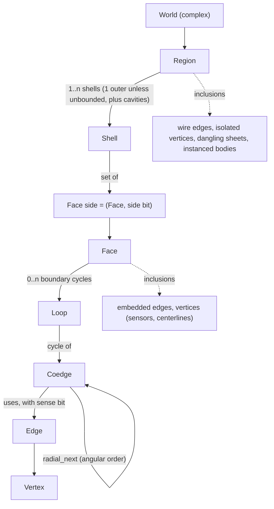

# 04 — Is a 2-manifold enough? Surfaces vs. volumetric cell complexes

Part of [B-rep topology research](README.md). This is the core question from
`docs/requirements.md`: *"Investigate whether a 2-manifold is enough or will we need a
3-manifold."*

## 0. Short answer

**A 2-manifold surface representation is not enough. A full 3-manifold or volumetric
mesh is not needed as the master model either.** What we need is a
**non-manifold, mixed-dimensional cell complex embedded in 3D space, with explicit
3-cells (regions)**:

* Region cells are bounded by face *sides* and are *not* required to be balls. A room
  with a column is a solid torus. A region of soil with a buried tunnel has a cavity.
* Faces are shared between the two regions they separate. Each wall face exists
  **once**.
* Lower-dimensional cells may float inside higher ones: sheets in air, wires in air,
  sensor vertices, and road centerlines on terrain.
* The interior of a region is **not tessellated** in the master model. Volumetric
  meshes (tets, voxels, FDTD grids) are *derived* products, labelled by region.

This is the "radial-edge / Parasolid general body / SGC" family. Implementation should
use PES-style economy (see [01](01-survey-classical.md)). Generalized maps
(3-G-maps) are rejected as the master model, for reasons given in §4.

The rest of this file justifies that answer against the project's use cases.

---

## 1. Terminology (it matters here)

* **2-manifold (surface):** every point of the surface has a neighbourhood that looks
  like a disk (or a half-disk on the boundary). Half-edge meshes represent these.
* **Non-manifold surface:** edges with k ≠ 2 faces, and vertices whose neighbourhood
  is several fans. BMesh represents these.
* **3-manifold (with boundary):** every point has a ball-like or half-ball-like
  neighbourhood. A *solid* is a 3-manifold with boundary. A *partition of space into
  regions* is a 3D cell complex whose union is 3-manifold-like, but whose cell
  boundaries form a non-manifold surface. For example, three rooms meeting at a wall
  junction give edges with 3–4 faces.
* **Cell complex in R³:** a partition of space (or of a bounded part of it) into open
  cells of dimension 0–3. This is the right object. "3-manifold" in the requirements
  most likely means "explicit volumes", and that is what this file addresses.

The key insight: **the surface is non-manifold *because* there are several regions.**
A partition of space into rooms, walls, soil, water, and air *forces* edges where 3+
faces meet. So "non-manifold B-rep" and "explicit regions" are two views of the same
structure. Storing only the faces discards the information about which side is which
region. That information is then recomputed, approximately, every time someone needs
it.

## 2. Use cases, analysed concretely

For each use case: what would a surface-only model (a 2-manifold per object, or a
non-manifold surface without regions) do, and what do regions add?

### 2.1 Buildings: rooms, shared walls, apertures

Scenario: indoor/outdoor drone detection, interior acoustic propagation, and line of
sight through windows. For example, a microphone array inside an atrium hears a drone
outside through an open skylight.

| Need | 2-manifold per object | NM surface, no regions | Cell complex with regions |
|---|---|---|---|
| Wall between room A and room B | Two coincident faces (one per room solid) or one thick wall solid with two faces | One face. "Which side is A?" requires a geometric radial sort plus shell traversal each time | One face; `region[front] = A`, `region[back] = B` |
| "Rooms adjacent to room A" | Proximity search plus tolerance tests | Shell traversal | Iterate A's face-sides and read `region[other side]` in O(boundary) |
| Window (aperture) in shared wall | Holes in both coincident faces must match exactly | Hole loop plus a glass face sharing the loop's edges | Same, plus the aperture face's sides name the two regions it connects |
| Room as an acoustic medium (volume, RT60, absorption) | Volume by divergence theorem on a closed manifold. A room is not a closed manifold if it shares walls | Must reconstruct the closed shell | Region's shells directly: volume, area-weighted absorption |
| Topological graph of spaces (portals) for search, visibility, coverage planning | Must be built externally | Must be built | **Dual graph is immediate**: regions are nodes, aperture faces are edges. This is Topologic's central result |

Coincident duplicate faces (the 2-manifold-per-room approach) are actively
*harmful* for simulation:

* **Ray tracing** (geometric acoustics, camera simulation): two coplanar triangles at
  the same location give non-deterministic hit ordering. Rays leak through
  T-junctions between mismatched tessellations. Transmission through a wall
  (A → wall → B) has no single interface to attach a transmission coefficient to.
* **Boundary element method (BEM)** for acoustics needs one interface surface with a
  well-defined medium on each side. Duplicated faces make the system singular.
* **Wave solvers on voxel grids** (FDTD, PSTD, TLM) need inside/outside classification
  per medium. Coincident shells cause classification flicker.

Real data: IFC distinguishes `IfcSpace` (rooms, volumetric) from elements, and
models 2nd-level *space boundaries* (the interface between a space and an element or
another space) for exactly these simulation reasons. CityGML 3.0 introduced an
explicit **Space / Space-Boundary** concept: rooms are physical spaces bounded by
wall surfaces. Topologic's `CellComplex` stores shared walls once and feeds energy
simulation directly. **The building-simulation community converged on explicit
volumes with shared interfaces.** Acoustic simulation has identical needs.

### 2.2 Thick walls vs. thin walls (LOD)

At low LOD, a wall is a *sheet*: one face between two rooms. At high LOD, a wall is a
*solid region*: two faces, plus a wall region with material "brick" between them.
LOD refinement then means **splitting a face into a region**: the face becomes two
faces with a new region between them. That is a well-defined complex operation, an
"inflate face" Euler-type operator. In a surface-only model, the wall-as-sheet and
the wall-as-solid are unrelated objects, and the room-to-room adjacency information
is lost across LODs.

Recommendation: regions carry a **material/medium**, and "wall" is either a face with
a transmission attribute (thin) or a region with a medium (thick). The adjacency graph
of *air* regions is preserved in both cases, by treating thin and thick walls as
equivalent separators.

### 2.3 Terrain, soil layers, water bodies, swamps

* **Terrain** is a sheet (open surface). Its sides are *air above* and *ground below*.
  To make "ground" a region, the model needs a bottom: a world box, or a soil-depth
  skirt. CGAL Nef's **infimaximal box** is the elegant version: a symbolic box at
  infinity that closes all regions.
* **Soil and geology layers:** stacked sheets give layered regions (topsoil, clay,
  bedrock). These are needed if ground-borne acoustic coupling or seismic sensors are
  in scope. Even if only "soil vs. air" matters, the region structure makes
  "underground" a queryable property (tunnels, culverts, basements).
* **Water bodies:** the surface (an air/water interface sheet), bed (a water/soil
  interface), and banks. A lake is a region bounded by the water surface and the bed.
  An island is a hole in the water-surface face *and* a separate land region. A river
  is a long region. A culvert under a road is a region passing through the road's
  embankment: a region with genus, which in turn makes the embankment region a solid
  torus. Sound speed, attenuation, and reflection coefficients differ by medium
  (air/water impedance mismatch is about 3500:1). Surface reflections off water are
  strong and specular, which matters for both acoustic and optical sensors.
* **Swamps and wetlands:** a mixed medium of water, emergent vegetation, and mud.
  Topologically this is one region with a medium that is a **field**: density or
  depth varying in space. The topology only needs to name the region. The medium
  model is attribute data (see the sibling research on attributes).
* **Forests:** a canopy layer acts as a *volumetric scatterer* for sound and a
  stochastic occluder for cameras. Model it as a region (the canopy volume between the
  canopy-top sheet and the canopy-base sheet) with field attributes (leaf area
  density, trunk density). Individual trees are **inclusions** in that region:
  instanced bodies that are not merged topologically (see §5.3).

A surface-only model can represent all the *interfaces*. It cannot tell you which
medium you are in, which is the first question every propagation or visibility
algorithm asks.

### 2.4 The atmosphere

The air above a city is one region, or a few: stratified layers, or a street canyon
separated from free air by a virtual sheet. Temperature and wind profiles refract
sound strongly: upward refraction by day, downward at night or downwind. That
is a **field over the air region**. Topologically it needs nothing beyond "this is the
air region" and the ability to insert **virtual (non-physical) sheets** that partition
regions for simulation: domain decomposition, perfectly matched layer (PML) boundary
regions, and coverage cells. Virtual faces must be first-class and flagged
`physical = false`, so that renderers and reflection solvers ignore them.

### 2.5 Acoustic simulation families and what each needs from topology

| Method | Typical use here | Needs from topology |
|---|---|---|
| Geometric acoustics (ray/beam/image-source tracing) | High-frequency drone noise in urban canyons, reflection paths, time difference of arrival (TDOA) multipath | Oriented faces with per-side material. An **edge set with dihedral angles** for diffraction (UTD, BTM). Which region a source or receiver is in. Aperture faces with transmission |
| Edge diffraction | Shadow zones behind buildings | Explicit *geometric* edges, with no fake bridge or seam edges, plus their incident faces and wedge angles. This is the radial cycle |
| BEM | Scattering from buildings, mid frequencies | Closed interface surfaces with the medium on each side. Shared faces, no duplicates |
| FDTD / PSTD / TLM / LBM (wave-based) | Low-frequency, complex geometry, validation | Voxelization by region: point-in-region classification. Region media. Derived grids |
| Parabolic equation (PE) / ray methods for long-range outdoor propagation | Long-range detection over terrain | Terrain profile along a vertical slice (sheet ∩ plane), ground impedance per face, and the atmosphere field |

Every row benefits from regions. Several (BEM, FDTD, transmission through walls) are
**incorrect or ill-posed without** a well-defined medium on each side of each face.

### 2.6 Cameras and vision

Visibility and occlusion work on surfaces. Volumetric regions add fog and haze
(atmospheric scattering per air region), water (refraction and underwater
cameras), vegetation canopy as a participating medium, and glass apertures. The same
region and medium attributes as acoustics, with different physics.

### 2.7 Site vulnerability surveys

Typical queries:
* "Which volumes of airspace are visible from sensor set S?" (coverage)
* "What approach corridors to target T avoid coverage?" (path planning in free space)
* "Which rooms or courtyards can a drone reach through which openings?" (dual graph)
* "Where are sensors mounted (wall/roof/pole) and what is their field of regard?"

These need: free-space regions (*air* regions, distinguished from solid and water);
the region and portal graph; and attachment of sensors (vertices) to faces and
regions. Coverage volumes themselves are derived voxel or BVH products. The topology
supplies classification, connectivity, and semantics.

### 2.8 Infrastructure

* **Tunnels and underpasses:** an air region with genus inside a soil region. A road
  sheet passes through it.
* **Bridges:** the deck is a sheet or solid over a road sheet, with a non-manifold
  junction at the abutments.
* **Power lines:** wire edges (catenaries, with a curve from a closed-form cosh) in the
  air region, between pole tops, which are vertices on pole solids. These are
  important for drone collision risk and as acoustic scatterers (negligible) or
  RF-relevant elements.
* **Fences:** sheets in air, possibly porous (an attribute). Both sides are the
  same region unless the fence closes a perimeter. A fence closing a compound
  *does* split air into regions, if the virtual sky-closure is added.
* **Pipes:** solids, or wires with a radius attribute at low LOD.

### 2.9 Summary of requirements

| Requirement | Surface-only (2-manifold) | NM surface (BMesh-like) | **NM complex + regions** | 3-G-map / LCC | Tet/volume mesh |
|---|---|---|---|---|---|
| Shared walls, once | ✗ | ✓ | ✓ | ✓ | ✓ |
| Medium per side / which region am I in | ✗ | recompute | ✓ | ✓ | ✓ |
| Regions with genus or cavities | n/a | n/a | ✓ | ✓ | ✓ |
| Wire edges (power lines) | ✗ | ✓ | ✓ | awkward | ✗ |
| Isolated vertices (sensors) | ✗ | ✓ | ✓ | awkward | ✗ |
| Open sheets (fences, terrain) | ✓ (as separate mesh) | ✓ | ✓ | awkward (free darts) | ✗ |
| Holes in faces | ✗ | ✗ (BMesh) | ✓ | ✗ natively | ✗ |
| Vertex- or edge-only contacts | ✗ | ✓ | ✓ | ✗ (identification) | ✗ |
| Curved geometry (B-spline, procedural) | ✓ | ✓ | ✓ | linear in CGAL | ✗ |
| Memory at city scale | low | low–mid | low–mid | mid–high | very high (interior tessellated) |
| LOD: face ↔ region refinement | ✗ | ✗ | ✓ | ✓ | remesh |

## 3. Why not "just" a non-manifold surface plus derived regions on demand?

This is BMesh's position: regions are a derived concept. It works for a modeling tool,
but fails here:

1. **Region identity must persist.** Rooms, water bodies, and soil layers carry
   attributes (medium, semantic class, IDs referenced by scenario files). If regions
   are recomputed, their IDs must be re-matched after every edit. That is a persistent
   naming problem *at the volume level*, and it is avoidable.
2. **Computing regions is geometric and expensive.** It needs a radial sort of faces
   around every non-manifold edge (exact predicates on curved surfaces), shell
   extraction, and then *shell nesting* (which shell is inside which: point-in-solid
   tests with ray casting). For a city that is a large computation, and it must be
   robust.
3. **Many operations must be region-aware anyway:** Booleans with selection
   ("keep everything that is soil"), LOD refinement, and the infimaximal world box.

The right compromise: **regions are stored, but derivable.** The structure has a
`rebuild_regions()` operation used after bulk imports and as a validity oracle. Normal
editing operators update regions incrementally. Splitting a face-bounded region by
inserting a closing sheet is a local operation.

## 4. Why not generalized maps (3-G-maps / 3-maps / LCC) as the master model?

They are the most principled "true 3-complex" structures, so the rejection needs
reasons:

1. **Quasi-manifold only.** Two buildings touching along a single edge, a pole
   touching a road at a point, or a power line ending at a vertex on a roof cannot be
   represented as *shared* topology. They become separate darts identified by a shared
   geometric attribute. That moves non-manifold topology back into geometry, which is
   the problem we were trying to solve.
2. **No holes in faces.** Cells are orbits, so a face is connected. Holes need
   inclusion trees or fictive edges, which are workarounds for the most common feature
   of building facades.
3. **Mixed dimension is awkward.** Isolated vertices, dangling wires, and dangling
   sheets need free involutions and special-casing in every orbit traversal.
4. **Memory.** A 3-G-map has a dart per (vertex, edge, face, volume) flag. A
   quadrilateral face between two volumes contributes 4 edges × 2 (α0) × 2 (sides) =
   16 darts. Each dart holds 4 links (α0..α3) plus one attribute handle per embedded
   dimension, so 16 × ~32 B ≈ 500 B for that face. A coedge design spends 4 coedges,
   one face record, and its share of edges and vertices, ≈ 200–250 B. So a 3-G-map
   costs roughly **2–3×** the memory of a coedge structure, and a 3-map roughly
   **1–1.5×**. These are back-of-envelope estimates, not measurements. The darts also
   duplicate work: every traversal touches 2–4× more records.
5. **Curved geometry.** In CGAL's LCC, geometry is points on vertices (linear).
   Attaching curves, surfaces, and pcurves is possible through i-attributes, but the
   pcurve's natural home (the oriented edge-in-face) is a *pair of darts* (one per
   α2 side). That is workable but unnatural.

Where G-maps shine is in **dimension-independent algorithms** (one code path for
2D/3D), **volumetric meshing**, and **image-based segmentation**. If we need those, we
*derive* an LCC or OpenVolumeMesh from the master complex.

## 5. Recommended structure: a stratified non-manifold cell complex

### 5.1 Entities

| Entity | Stored data (index layout; see [06](06-memory-layout-performance.md)) |
|---|---|
| **Vertex** | point/geometry ref, tolerance, `first_edge` (or a CSR adjacency slot), container (region/face/edge if isolated or embedded) |
| **Edge** | `v[2]`, curve ref + param range, tolerance, `any_coedge` (−1 for a wire edge), container (region/face for wire or embedded edges) |
| **Coedge** (edge-use in a face loop; one per face-edge incidence, *not* per face side) | `edge`, `sense` bit, `loop`, `next`, `prev`, `radial_next`, `radial_prev`, pcurve ref |
| **Loop** | `face`, `first_coedge`, `next_loop` |
| **Face** | `first_loop`, surface ref + sense, `region[2]` (front, back), `shell[2]`, flags (physical/virtual, aperture), tolerance |
| **Shell** | `region`, `first_face_side`, cached bbox, (genus/orientation cache) |
| **Region** | `first_shell`, medium/attribute key, `is_unbounded` |

Key economies relative to radial-edge:

* **No face-uses or loop-uses.** A face side is `(face, bit)`. Face-uses are *implied*.
* **One coedge per face-edge incidence**, not two. The coedge serves both sides of
  its face, and the side is selected by orientation. The radial order around an edge
  interleaves faces. The region in the *wedge* between radially consecutive coedges
  c_i and c_{i+1} is `face(c_i).region[side_facing_next]`. This is the PES idea.
* **The disk cycle is not stored** in the frozen form (derive vertex → edge adjacency
  as a CSR table). In the editable form, keep a small per-vertex edge list. See
  [06](06-memory-layout-performance.md).

### 5.2 Mixed-dimensional elements

| Element | Example | Representation |
|---|---|---|
| Isolated vertex | Microphone, camera, drone waypoint, survey benchmark | Vertex with no edges; `container = region` (in air) or `face` (on a wall) |
| Wire edge | Power line, road centerline (before road surface generation), pipe at low LOD, building outline in 2D plan | Edge with no coedges; `container = region` or `face` (embedded) |
| Embedded edge in face | Lane marking or centerline on terrain without imprint | Edge in the face's inclusion list, with a pcurve on the face |
| Sheet (open face) | Fence, terrain patch, canopy top, virtual partition | Face whose boundary edges have radial-degree 1. Both sides may be the *same* region |
| Solid | Building mass, wall slab, pole, tank | A region with medium ≠ air, bounded by shells |
| Body / object | A semantic grouping (one building, one tree prototype) | **Not a topological entity**: a set of cells plus a semantic ID in the attribute system (see §5.4) |

Note the deliberate absence of Parasolid-style *body types*. "Solid", "sheet", and
"wire" are derived classifications of a set of cells, not storage classes.

### 5.3 Inclusions vs. merged topology (scale management)

Not everything should be merged into one city-wide complex:

* **Merged** cells share topology: rooms, walls, terrain and its imprinted roads, water
  bodies. These need adjacency and shared interfaces.
* **Included bodies** are separate complexes (often instanced prototypes: trees,
  vehicles, street furniture) *placed inside* a region of the main complex by
  reference + transform. They do not split the containing region's topology. The
  region's medium is "air minus included bodies", resolved lazily by queries (BVH over
  instances).

This is where instancing belongs: at the **object level**, as a reference to a
prototype complex, never per sub-shape as in OCCT locations. A forest of 10⁶ trees
must not create 10⁶ cavities in the air region. If a specific analysis needs a tree
merged (high-fidelity BEM around one tree), it **imprints** that instance locally into
a copy of the complex.

### 5.4 Semantic grouping above topology

"Building 12", "room 3.04", "north facade", "road segment R7" are **semantic objects**
that reference sets of cells. They are not cells themselves. A room might be one
region at LOD2 and three regions at LOD4 (split by a virtual sheet for simulation
domains). Keeping semantics in a separate layer, with cell-set membership via
attributes, lets LOD and simulation subdivisions change the cells without changing
semantics.

### 5.5 The unbounded region and the world box

There is always exactly one unbounded region (Parasolid's infinite void, Nef's
infimaximal box). Terrain is an open sheet. To make "below ground" a region, close the
model with a **symbolic world box**: virtual faces at ±"infinity" that are never
tessellated or rendered. Simulation domains can replace it with real truncation
boundaries (PML regions).

## 6. Risks and mitigations

| Risk | Mitigation |
|---|---|
| Regions make every edit operator more complex (region bookkeeping) | Most procedural generation is *construction*, not editing. Build per-object complexes, then merge with an arrangement step that computes regions once. Provide `rebuild_regions()` as a fallback and as a test oracle |
| Radial ordering of curved faces around an edge needs robust geometric comparison | Compare tangent-plane normals at an edge point, then curvature for ties (standard in Parasolid and ACIS). Use exact or filtered predicates for planar faces, which dominate building data. Cache the ordering in `radial_next` |
| City scale: one complex is too big | Spatial tiling. One complex per tile, with **virtual tile-boundary faces** shared between tiles. Inclusions for instanced content |
| Imported data (CityGML, OSM, IFC) is not watertight | Region building must be tolerant: snap-rounding plus tolerance-based merging, then the arrangement. Unclosed shells degrade to sheets with region = surrounding air, and are flagged |
| Developers find non-manifold code harder | Provide manifold *views* (per-shell half-edge export) for algorithms that want them |

## References

* K. Weiler, *Topological Structures for Geometric Modeling*, RPI 1986 — https://www.scorec.rpi.edu/reports/view_report.php?id=597
* S. H. Lee, K. Lee, Partial entity structure, SMA 2001 — https://dl.acm.org/doi/10.1145/376957.376976
* J. Rossignac, M. O'Connor, SGC (overview): https://cgvr.cs.uni-bremen.de/teaching/cg_literatur/SIG96sgc.pdf
* CGAL Nef_3 (sphere maps, infimaximal box): https://doc.cgal.org/latest/Nef_3
* CGAL Linear Cell Complex: https://doc.cgal.org/latest/Linear_cell_complex
* P. Lienhardt, n-G-maps and cellular quasi-manifolds, IJCGA 1994, doi:10.1142/S0218195994000173
* OpenVolumeMesh: https://www.graphics.rwth-aachen.de/software/openvolumemesh/
* Topologic (CellComplex, shared faces, energy simulation): https://orca.cardiff.ac.uk/113472/1/AAG2018_Topologic_ORCA.pdf ; https://aecmag.com/simulation/topologic-modelling-space-the-inverse-of-bim/
* CityGML 3.0 space concept: https://link.springer.com/10.1007/s41064-020-00095-z ; OGC approval: https://www.gim-international.com/content/news/citygml-3-0-conceptual-model-approved-as-official-ogc-standard
* IFC space boundaries (buildingSMART IFC4 `IfcRelSpaceBoundary`): https://standards.buildingsmart.org/IFC/RELEASE/IFC4/ADD2_TC1/HTML/schema/ifcproductextension/lexical/ifcrelspaceboundary.htm
* Q. Zhou, E. Grinspun, D. Zorin, A. Jacobson, "Mesh arrangements for solid geometry", SIGGRAPH 2016 — https://www.cs.columbia.edu/cg/mesh-arrangements
* Biot–Tolstoy–Medwin edge diffraction: U. P. Svensson et al., "An analytic secondary source model of edge diffraction impulse responses", JASA 106, 1999 — https://doi.org/10.1121/1.428071
* Boris Dalstein et al., VGC (non-manifold 2D complexes): https://www.borisdalstein.com/research/vgc/
