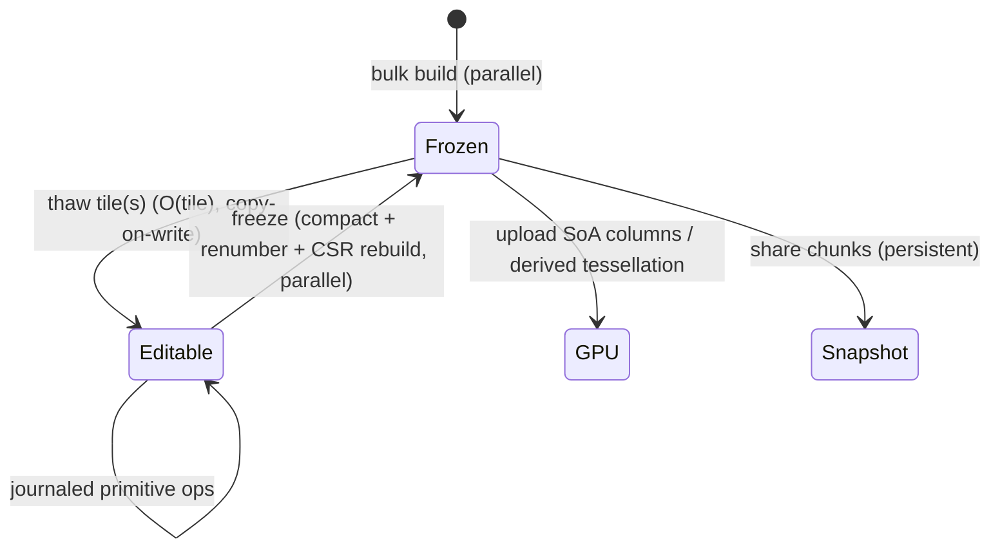

# 06 — Memory layout, performance, parallelism, persistence, and naming

Part of [B-rep topology research](README.md). This file assumes the entity set from
[04 §5](04-surface-vs-volumetric.md): Vertex, Edge, Coedge, Loop, Face, Shell, Region,
plus inclusions.

## 1. Pointer-based vs. index-based

| Aspect | Pointer graph (BMesh, ACIS, Parasolid, OCCT handles) | Index/arena (OpenMesh, Surface_mesh, OpenVolumeMesh, geometry-central, Blender `Mesh`) |
|---|---|---|
| Link size | 8 B | 4 B (32-bit index; 2³² ≈ 4×10⁹ elements per tile is plenty) |
| Locality | Depends on the allocator. Mempools help, but nodes scatter after edits | Contiguous per entity type. Traversal order can be renumbered for locality |
| Attributes | Per-element blocks (BMesh CustomData) or attribute chains (ACIS) | **SoA columns**, one array per attribute: vectorizable, GPU-uploadable, sharable |
| Serialization | Needs pointer swizzling | `memcpy` / mmap of the arrays |
| GPU | Impractical | Direct upload |
| Deletion | Free the node | Tombstone + free-list. Compaction remaps indices |
| Stale references | Dangling pointers (UB) | Stale index silently aliases a new element **unless** generation-checked |
| Copy / snapshot | Deep copy: O(n) allocations | Array copies, or chunk-level copy-on-write sharing (§5) |

**Recommendation: index-based SoA arenas.** Blender's history is the evidence: its
storage `Mesh` was moved to SoA in 2022–23, giving ~2× faster mesh building in Cycles,
28% gains from splitting `MLoop` into `corner_verts`/`corner_edges`, and copy-on-write
attribute sharing. BMesh stayed pointer-based for editing. We should not repeat that
split ([02 §4](02-survey-systems.md)).

## 2. Handles: internal indices vs. external generational handles

Two kinds of references with different requirements:

* **Internal links** (coedge.next, edge.v[0], and so on) are raw `u32` indices. The
  structure's invariants guarantee they are live. Checking generations on every hop
  would waste bandwidth.
* **External handles** (held by attribute layers, semantic objects, procedural
  caches, scripting, undo stacks) are `(index: u32, generation: u32)`, the
  *slot-map* / *generational arena* pattern. A handle to a deleted-and-reused slot
  fails cleanly instead of aliasing.
* **Persistent IDs** (§7) are a third, *stable across versions and recomputation*
  identity. They are not storage locations.

Keep the three distinct. Conflating storage index and identity is the root of
OCCT's (and thus FreeCAD's) naming fragility, and of Fornjot's handle-everywhere
complexity.

## 3. Proposed layout

### 3.1 Tables (SoA)

```
Vertex   : pos[f64x3]* | tol[f32] | edge_off[u32] (CSR) | container[u32+tag] | gen[u32] | flags[u8]
Edge     : v0[u32] v1[u32] | curve[u32] | t0,t1[f64] | tol[f32] | coedge[u32] (any, or NONE)
           | container[u32+tag] | gen | flags
Coedge   : edge[u32] | loop[u32] | next[u32] | prev[u32] | radial_next[u32] | radial_prev[u32]
           | sense[bit] | pcurve[u32]
Loop     : face[u32] | first[u32] | next_loop[u32]
Face     : first_loop[u32] | surface[u32] | sense[bit] | region[2][u32] | shell[2][u32]
           | tol[f32] | first_incl[u32] | gen | flags (virtual, aperture, ...)
Shell    : region[u32] | first_faceside[u32] | bbox[f32x6]
Region   : first_shell[u32] | first_incl[u32] | medium[u32] | flags (unbounded)
```

`*` Positions in tile-local coordinates (see [07 §6](07-geometry-embedding.md)). For
geometry-backed vertices, `pos` is a cache of the evaluated point.

Per-element sizes (approximate, with `gen` and flags): vertex ≈ 48 B, edge ≈ 56 B,
coedge ≈ 28 B, loop 12 B, face ≈ 52 B. For a typical *quad-dominant closed* model
with F faces (E ≈ 2F, V ≈ F, coedges = 4F, loops ≈ 1.1F), the cost is ≈ 4·28 + 2·56 +
48 + 13 + 52 ≈ **340 B/face including geometry references**, before geometry payloads
and attributes. A pure manifold half-edge mesh is about 120–160 B/face for comparison.
These numbers are estimates. The extra is the price of non-manifold support, holes,
regions, and tolerances. It is dominated by edges and coedges, which suggests:

* `radial_prev` can be dropped: the radial cycle is usually length 2 and at most ~6.
  Walk forward to find a predecessor. Saves 4 B per coedge.
* `prev` in loops can be dropped similarly: loops average 4–6 coedges.
* Edge param ranges `t0,t1` can move into the curve table when the curve is
  edge-private, which is the common case.

### 3.2 Upward adjacency: CSR in frozen form, small vectors in edit form

The disk cycle (vertex → incident edges) is the most expensive relation to maintain
under edits. BMesh pays 4 pointers per edge for it. Use two forms:

* **Frozen:** vertex → edges as **CSR** (an offsets array plus an edge-index array),
  built in parallel by counting sort. Read-only, compact, cache-perfect.
* **Editable:** per-vertex small inline vectors (for example, capacity 4 inline plus
  overflow in a side arena), *or* lazily rebuilt CSR for dirty tiles only.

Face → region and coedge → radial are stored because they are needed constantly and
are cheap. Region → faces is the shell's face-side list, stored as a CSR array per
shell in frozen form.

### 3.3 Ordering for locality

After bulk build or compaction, renumber elements along a **space-filling curve**
(Morton or Hilbert order on the centroid) *within each tile*. Store coedges of the
same loop contiguously, so that `next` is usually `+1`. That makes loop traversal
almost a linear scan. In the frozen form, loops can even be stored as `(first, count)`
ranges with implicit next.

## 4. Two forms, one structure: "frozen" and "editable"



* **Frozen:** dense, compacted, Morton-ordered, CSR adjacency, immutable, and
  shareable between threads, versions, and processes. All heavy *queries* run here:
  ray casting, region classification, tessellation, simulation export.
* **Editable:** the same SoA tables plus free-lists, tombstones, and small-vector
  adjacency, for the tiles being edited only.
* The two forms share the column layout. Freezing is compaction plus renumbering,
  **not** a format conversion. This is the anti-BMesh lesson.

## 5. Persistence: immutable versions for procedural caching and undo

Procedural modeling evaluates a node graph. Caching requires that a node's output be
an **immutable value** that later nodes can share and modify cheaply.

### 5.1 Chunked copy-on-write columns

Store each SoA column as a sequence of fixed-size **chunks** (for example, 4–16K
elements), referenced by refcounted pointers. This is the same idea as Blender's
implicit sharing of attribute arrays, at chunk granularity, and similar to RRB-vector
persistent arrays (the `immer` library).

* A version is a set of column chunk-lists.
* An edit copies only the chunks it touches (path copying). Spatial tiling plus Morton
  order make edits touch few chunks.
* Undo means keeping old versions alive. Memory cost ≈ touched chunks only.
* **Content hashing** per chunk gives cheap equality and memoization keys for the
  procedural cache. Two evaluations that produced identical tiles share storage.

### 5.2 Why not a pointer-based persistent graph (Fornjot style)?

Fornjot uses immutable objects in append-only stores with handles. That gives
structural sharing, but every update creates new objects up the reference chain. A
cyclic, densely linked B-rep (radial, loop, and disk cycles) is a poor fit for
DAG-style path copying: changing one coedge's `radial_next` requires new versions of
everything that points to it. Fornjot's own move to separate "owned" from "shared"
topology reflects that friction. **Chunked arrays sidestep the problem**: links are
indices, so a changed element is changed in place within a copied chunk, and nothing
that points to it needs a new version.

### 5.3 Journal + versions

Journaled primitive ops ([05 §2.4](05-invariants-operators-validity.md)) plus chunked
versions give:

* fine-grained undo (journal inverse) *and* coarse snapshot undo (keep the version);
* diff between versions (journal or chunk hash comparison), useful for incremental
  re-tessellation and simulation re-meshing (only dirty tiles);
* deterministic replay for debugging (record the journal of a failing procedural run).

## 6. Parallel construction and editing

### 6.1 Parallel bulk build (from polygon soup or procedural emitters)

Generators emit faces as vertex cycles, with optional loops, plus geometry references.
The build is:

1. **Vertex welding:** spatial hash or sort on quantized positions, followed by
   tolerance-aware union-find. Parallel.
2. **Edge identification:** for each coedge (a, b), key = (min(a, b), max(a, b), curve
   id if curved). Radix-sort keys and run-length group them into edges. This is a
   parallel sort plus a prefix sum.
3. **Radial cycles:** each group of coedges on one edge is sorted *angularly* around
   the edge (tangent-plane normals at the edge midpoint; exact predicates for planar
   faces). Each edge is independent: embarrassingly parallel.
4. **Loops:** next and prev come from the emitter order (contiguous). The loop table is
   a prefix sum.
5. **Disk CSR:** counting sort of edge endpoints.
6. **Regions:** label face-sides by flood fill across radial wedges (the shell walk),
   using parallel union-find over face-sides with the edge-wedge adjacency. Then nest
   the shells by point-in-shell queries on a BVH. Parallel per shell.

This is the same structure as Dupuy & Vanhoey's GPU half-edge construction and
refinement. Every step is a sort, scan, or map: **GPU-implementable** if needed.

### 6.2 Parallel editing

* **Spatial tiles** are the unit of concurrency. Each tile is an independent complex
  with its own arenas. Tiles share **virtual boundary faces and edges** that are
  replicated in both neighbours with a common persistent ID.
* Edits that stay within a tile run concurrently. Edits that cross tiles take tile
  locks in a canonical order, or run as a two-phase commit at the tile-boundary
  replica.
* Within a tile, *bulk* operators (arrangements, sweeps) parallelize internally.
  *Interactive* single edits are cheap enough to run serially.
* Readers never block. They hold an immutable version (§5).

### 6.3 GPU friendliness

* Frozen SoA columns upload as-is: coedge `edge/next/radial_next`, face
  `first_loop/region`, CSR arrays. GPU kernels can run region classification, ray
  queries (with a BVH over the tessellation), and visibility on them.
* Topology *edits* on the GPU are not worth it, except for regular refinement
  (subdivision, adaptive tessellation), where half-edge refinement rules are known to
  map well (Dupuy & Vanhoey 2021).
* Most GPU work will consume **derived tessellations** with per-triangle
  `(face_id, side→region)` tags, not the B-rep itself.

## 7. Topological naming and persistent IDs

### 7.1 The problem

In history-based CAD, a downstream feature references "Face 7". After an upstream
edit, re-evaluation renumbers the faces, and "Face 7" is now a different face.
FreeCAD's well-known *topological naming problem* is this, made worse by OCCT having
no stable sub-shape identity. FreeCAD 1.0 merged realthunder's **element map**
mitigation: names that encode the generating operation and source element history.
It *mitigates* the problem. FreeCAD's documentation still recommends datum references
for stability.

The literature on persistent naming is long: Kripac 1997 (topological ID system, face
history graph), Capoyleas, Chen & Hoffmann 1996 (generic naming), Marcheix & Pierra
2002 (survey), Agbodan et al. 2003 (entity matching), and Rappoport's GGC (invariant
naming for shape families).

### 7.2 Why this project has an *easier* version of the problem

Interactive CAD must infer intent from geometry after the fact. **Procedural
generators know their semantics at creation time.** "Building 12 → floor 3 → north
wall → window 2 → left reveal face" can be *assigned* when the face is created.

### 7.3 Recommended scheme: provenance-derived IDs

* Every cell carries a **persistent ID** (`u64`, or `u128` for collision-safety at
  city scale), stored as a column.
* Generators assign IDs as `hash(node_id, semantic_key)`, where the semantic key is
  generator-defined: (building idx, floor idx, "wall", "N", window idx).
* **Every primitive op defines child IDs deterministically from parents.** For
  example, a split of face f along curve c gives `hash(f, c_id, side ∈ {L, R})`, a
  merge gives `min(ids)` or `hash(sorted ids)`, and an inflate gives
  `hash(f, "front"/"back"/"region")`. Sides are defined by *geometric orientation
  relative to the splitting entity*, never by storage order. This keeps IDs
  independent of thread scheduling and evaluation order.
* The **journal** records lineage (created-from, split-from, merged-from). External
  references can be **resolved forward** across versions ("face X was split into X.L
  and X.R; the reference policy says follow both or pick the larger").
* Persistent IDs are distinct from storage indices (§2) and from generational handles.
  A hash map `persistent_id → index` per frozen version is built lazily.
* **Determinism requirement:** IDs must not depend on thread scheduling. The parallel
  build (§6.1) must sort keys canonically before assigning IDs.

This also supports **LOD linking**: the LOD4 wall faces carry lineage back to the LOD2
facade face, so scenario annotations made at one LOD resolve at another.

## 8. Compaction

* Editable tiles accumulate tombstones. Compaction runs when tombstones exceed about
  25%, or at freeze.
* Compaction produces an `old → new` index remap. Internal links are rewritten in one
  parallel pass. External generational handles are invalidated by design (the
  generation is bumped), and holders re-resolve via persistent ID. Attribute columns
  are permuted by the same remap.
* Because frozen versions are immutable, compaction always produces a *new* version.
  Readers of the old version are unaffected.

## 9. Performance checklist (things to measure early)

1. Bulk build throughput: target ≥ 10M coedges/s per core-equivalent on planar
   building data (sort-dominated). This is a target, not a measured figure.
2. Memory per face for a typical building tile vs. a manifold half-edge baseline
   (expect ~2–2.5×).
3. Region rebuild time for a city tile (radial sort plus flood fill plus shell
   nesting).
4. Freeze/thaw latency for an interactive edit (target: < 1 frame for a 100k-face
   tile).
5. Snapshot memory overhead for 100 undo steps of local edits (target: chunk-bounded).

## References

* Blender Mesh SoA refactor: https://developer.blender.org/T95965 ; https://projects.blender.org/blender/blender/pulls/104424 ; https://projects.blender.org/blender/blender/issues/93602
* BMesh design: https://wiki.blender.org/features/objects/mesh/bmesh/
* OpenVolumeMesh (index-based complex): https://www.graphics.rwth-aachen.de/software/openvolumemesh/
* CGAL Surface_mesh (index + property maps): https://doc.cgal.org/latest/Surface_mesh
* geometry-central: https://geometry-central.net ; PMP library: https://www.pmp-library.org
* J. Dupuy, K. Vanhoey, "A halfedge refinement rule for parallel Catmull-Clark subdivision", CGF 2021 — https://diglib.eg.org/handle/10.1111/cgf14381
* Generational arenas / slot maps: https://docs.rs/slotmap ; https://docs.rs/generational-arena
* immer (persistent RRB vectors, C++): https://github.com/arximboldi/immer
* Fornjot storage and objects: https://docs.rs/crate/fj-core/latest/source/src/objects/mod.rs ; https://docs.rs/crate/fj-core/0.49.0/source/src/storage/store.rs
* FreeCAD topological naming problem: https://wiki.freecad.org/Topological_naming_problem ; issue: https://github.com/FreeCAD/FreeCAD/issues/8432 ; realthunder's element map: https://github.com/realthunder/FreeCAD_assembly3/wiki/Topological-Naming
* J. Kripac, "A mechanism for persistently naming topological entities in history-based parametric solid models", CAD 29(2), 1997 — https://scilit.com/publications/27dcc93055f03e680baf99c7fedc3a5f
* V. Capoyleas, X. Chen, C. M. Hoffmann, "Generic naming in generative, constraint-based design", CAD 28(1), 1996.
* D. Marcheix, G. Pierra, "A survey of the persistent naming problem", ACM SMA 2002.
* D. Agbodan et al., "A topological entity matching technique", 2003 — https://www.lias-lab.fr/publications/7076/2003-ICSMA-AGBODAN.pdf
* A. Rappoport, GGC (invariant naming): https://www.cs.huji.ac.il/~arir/ggc.pdf
